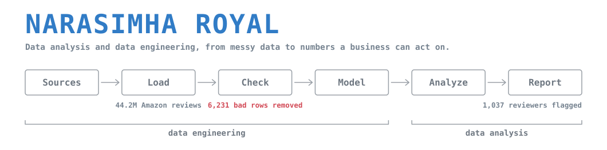
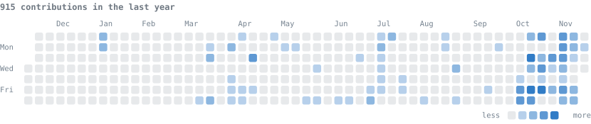

  

  <a href="https://narasimharoyal.com/">Portfolio</a> &nbsp;·&nbsp;
  <a href="https://www.linkedin.com/in/narasimha31/">LinkedIn</a> &nbsp;·&nbsp;
  <a href="mailto:narasimharoyal31@gmail.com">narasimharoyal31@gmail.com</a>

  Data analyst in Houston. I turn messy, multi-source data into numbers people can trust, and I build the pipeline underneath when a project needs one.

| Area | Tools |
|---|---|
| **Languages** | `SQL` `Python` `DAX` |
| **Analytics & BI** | `Power BI` `Excel` `pandas` `NumPy` `Tableau` |
| **Databases & Cloud** | `PostgreSQL` `Snowflake` `BigQuery` |
| **Data Engineering** | `Airflow` `dbt` `Kafka` `Great Expectations` `Docker` |
| **Geospatial** | `PostGIS` `GeoPandas` `QGIS` |

### [Semiconductor Import Concentration Risk: Streaming Pipeline with a Text-to-SQL Agent](https://github.com/narasimha-31/Supply-Chain-Risk-Analytics-with-AI-Agent)
**Question:** How much do U.S. chip imports depend on a handful of countries? 
**Found:** In some months a single country supplied up to **58%** of U.S. memory-chip import value. Anyone can ask the data in plain English through a text-to-SQL assistant. 
`Kafka` `Airflow` `dbt` `PostgreSQL` `BigQuery` `Great Expectations` `Docker`

### [Fake Review Detection at Scale: Rating-Sentiment Mismatch Across 44M Amazon Reviews](https://github.com/narasimha-31/Review-Sentiment-Fake-Review-Detection)
**Question:** How often do a review's words disagree with its stars, and who is gaming the ratings? 
**Found:** Across **44.2M** Amazon reviews, the text and the rating disagree in about **1 in 5**. A behaviour-based risk score flagged **1,037** reviewers for a manual look. 
`Python` `PostgreSQL` `Airflow` `VADER` `Power BI`

### [Detecting and Prioritizing Utility Asset Location Errors in GIS Maps](https://github.com/narasimha-31/utility-asset-location-errors-gis)
**Question:** Where do two public maps of Houston's power grid disagree about where things are? 
**Found:** **474** findings across central Houston, ranked by FEMA flood risk so the riskiest get checked first. 
`PostGIS` `GeoPandas` `QGIS` `Python`

### [GasBook: Stress-Testing Value at Risk for Natural Gas Trading Through Winter Storms](https://github.com/narasimha-31/GasBook---Natural_Gas_Trading_Risk_Analytics)
**Question:** Does the daily risk number a gas trading desk relies on hold up in a winter storm? 
**Found:** Before the January 2024 cold snap it said **15%**. The real move was **319%**. Tested on 29 years of public price data. 
`Python` `PostgreSQL` `scikit-learn` `statsmodels` `React`

### [Tesla Energy Warehouse Storage Analytics: Simulated Daily Operations from Public Quarterly Filings](https://github.com/narasimha-31/Energy-Storage-Inventory-Analytics)
**Question:** Which battery storage site is about to run short, and is production keeping pace? 
**Built:** Daily inventory simulated in Python and forced to add back up to Tesla's real quarterly figures from its SEC filings, on a star schema with three Power BI pages. 
`Python` `PostgreSQL` `Power BI (DAX)` `SQL`

  

